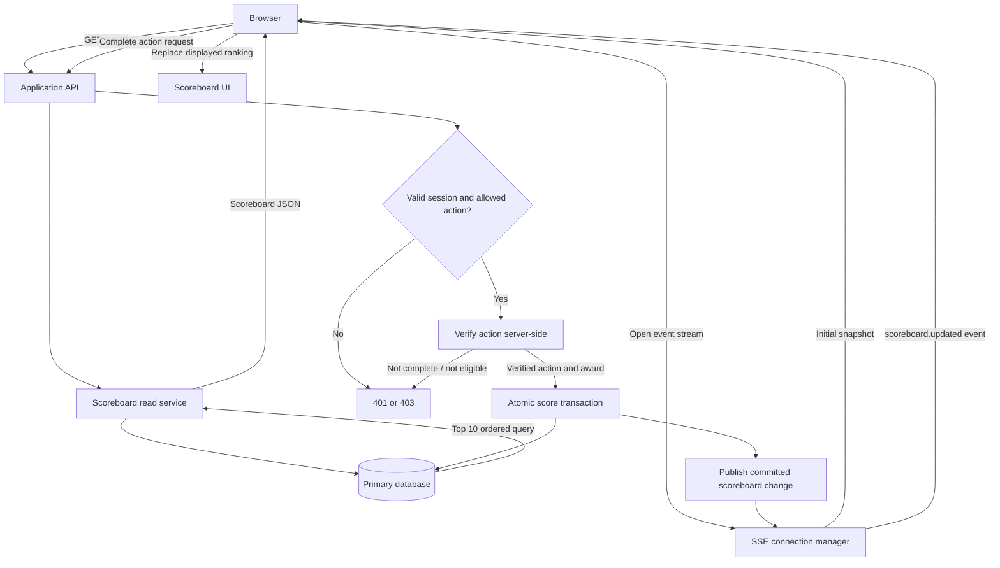

# Problem 6: Live Scoreboard Module

## Goal

Specify a backend module for a website that displays the ten highest user scores and updates connected viewers when the ranking changes. Completing a qualifying action increases a user's score. The application server must verify the action and authorize the score change; it must never accept a score total supplied by the browser.

## Proposed module

**Scoreboard Service** owns score mutations, ranking reads, and leaderboard change notifications. It sits behind the existing application API and uses the existing identity provider/session middleware.

### Interfaces

| Interface | Contract |
| --- | --- |
| `GET /api/scoreboard?limit=10` | Public read. Returns `{ users: [{ userId, displayName, score, rank }], updatedAt }`, ordered by score descending and then stable user ID ascending. Limit is capped at 10. |
| `POST /api/actions/:actionId/complete` | Authenticated action completion. The server loads the action, verifies eligibility and completion, then applies the configured score award. Returns the updated score and action receipt. Replaying the same action has no additional effect. |
| `GET /api/scoreboard/events` | Server-Sent Events stream. Emits `scoreboard.updated` with the same top-10 payload after a committed change affects the displayed ranking. |

The browser may request an action completion, but only a trusted service or server-side rule determines whether it succeeded and how many points it awards. If an action is confirmed by an external provider, verify its signed callback or query that provider from the server before scoring.

## Execution flow

## Data and consistency

- Persist a score row keyed by user, plus an immutable score event/receipt keyed by action. Store the award, reason, timestamp, and actor/service identity for audit and support.
- In one database transaction, claim the unique action receipt and increment the user's score. A unique constraint on the action receipt makes retries idempotent; rollback both writes if either fails.
- Read the top ten from the primary or a strongly consistent replica. Index by `(score DESC, user_id ASC)`; apply the exact same stable tie-break in every response.
- Publish only after commit. Use a transactional outbox (or equivalent durable change log) so a process restart between commit and publish cannot silently lose a live update. SSE clients reconnect with `Last-Event-ID`; on reconnect, send a fresh snapshot before subsequent events.
- If an update changes only a score below the displayed cutoff and does not alter any top-ten row, the server may skip broadcasting. Periodic snapshot refresh repairs missed client state.

## Authorization and abuse controls

- Authenticate action requests from the established secure session/token. Derive `userId` from that identity; ignore any user ID in request data.
- Authorize the specific action against server-side ownership, eligibility, and completion state. Do not expose a generic `POST /score` endpoint.
- Never accept an increment amount from the client. Map verified action types to server-owned award values and enforce per-action limits.
- Enforce idempotency, rate limits, replay protection, input validation, and audit logging. Require CSRF protection when cookie sessions are used.
- Treat leaderboard display names as untrusted text; escape them at render time. Return only public profile fields and avoid exposing email or account metadata.
- Protect provider callbacks with signature verification, timestamp/replay checks, and event-ID deduplication. Restrict administrative score adjustments to a separate privileged path with reason and audit record.

## Operational behavior

- Use TLS for API and event streams. SSE is one-way and fits scoreboard notifications; use a heartbeat to keep intermediaries from closing idle streams.
- On database or publish failure, do not report a successful score change until the transaction commits. Durable outbox processing retries notifications independently.
- Monitor score transaction failures, duplicate action receipts, outbox age, active event connections, and event delivery lag. Keep the database as the source of truth; event messages are invalidation/update hints.

## Delivery checks

Verify ordered top-ten reads and tie-breaking; reject unauthenticated and unauthorized actions; prove duplicate action requests award points once; test transaction rollback; confirm committed updates reach connected clients and reconnects receive a fresh snapshot.
